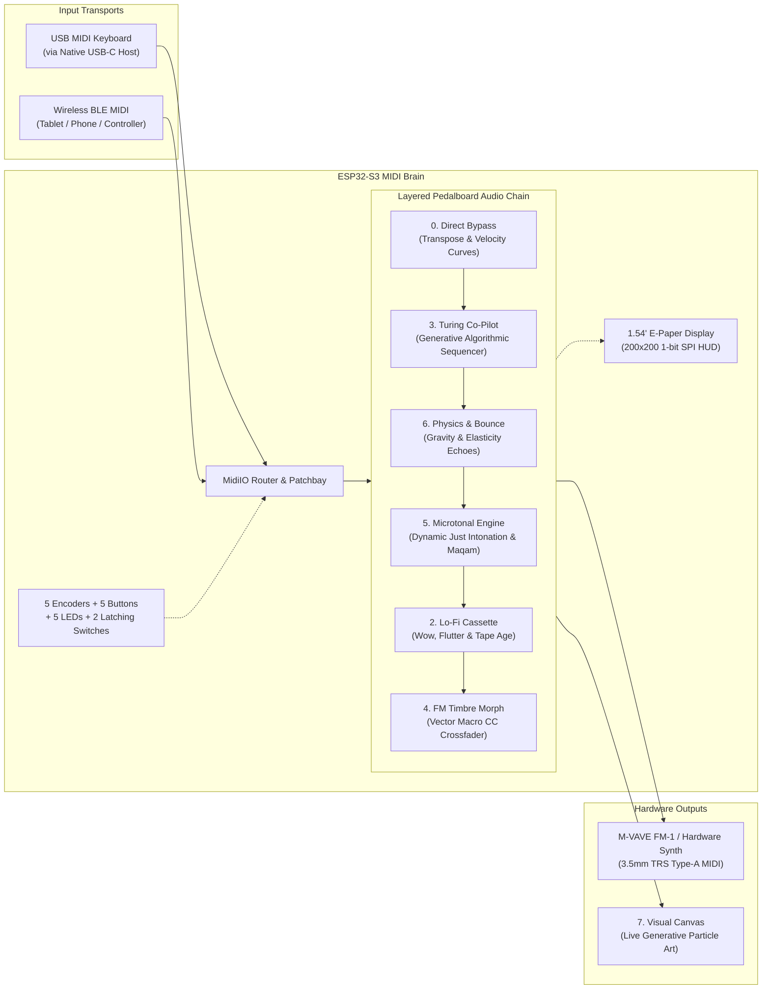

# MIDI-S3: Universal Hardware MIDI Brain & Generative FX Pedalboard

A standalone, computer-free MIDI processor, generative sequencer hub, and multi-engine transformation pedalboard powered by the **ESP32-S3**.

Designed to sit between any class-compliant USB MIDI keyboard / controller and hardware synthesizers (such as the **M-VAVE FM-1**, Roland boutique units, Korg Volcas, or desktop modules), **MIDI-S3** bridges USB, BLE, and wired TRS Type-A MIDI while running a serial chain of generative, algorithmic, and acoustic transformation engines in real time.

---

## 🏗️ System Architecture



---

## 🌟 Key Features

* **100% Computer-Free & Standalone:** Powered by a dual-core 240MHz ESP32-S3. No computer or DAW required for performance.
* **Triple-Transport MIDI Hub:**
  * **Native USB Host (OTG):** Plug any class-compliant USB MIDI keyboard or pad controller directly into the USB-C port via an OTG adapter.
  * **Wireless BLE MIDI:** Connect wireless keyboards, tablets, or phones over low-latency Bluetooth Low Energy MIDI.
  * **Wired TRS Type-A 3.5mm MIDI OUT:** Drives standard 3.3V hardware synths with sub-millisecond latency.
* **Stackable Multi-Engine Pedalboard Architecture:** Sound engines run simultaneously in a serial audio chain (`Bypass ➔ Turing ➔ Physics ➔ Microtonal ➔ Lo-Fi ➔ Morph ➔ Outputs & Visualizer`).
* **Tactile Hardware Interface:**
  * **4 Parameter Rotary Encoders (EC11):** 1:1 control of the 4 on-screen column parameters with click-to-reset.
  * **1 Dedicated Navigation Encoder:** Smoothly cycle all 8 screen views; click to jump directly to the Visual Canvas.
  * **5 Dedicated Sound Layer Buttons:** Toggle individual sound engines `[ON/OFF]` in the audio chain instantly without interrupting your current screen view.
  * **5 Dedicated Status LEDs:** Immediate visual feedback showing which audio layers are active.
  * **2 Latching Toggle Switches:** Hardware Master Bypass switch and Mode-Specific Performance Action switch (Freeze, Tape Brake, Infinite Bounce).
* **1.54" E-Paper HUD (Waveshare SSD1681/SSD1608):**
  * Sunlight-readable 200×200 1-bit crisp display.
  * Live status bar displaying active layers `[L][T][M][U][P]`, connected USB device name, and parameter readouts.
* **Auto-Save & Factory Reset (NVS Flash):** Auto-saves all parameter tweaks and routing to ESP32 Flash after 3 seconds of inactivity.
* **Zero External Library Dependencies:** Custom native ESP32-S3 USB Host MIDI driver, BLE MIDI GATT service, and 200×200 SPI framebuffer graphics engine are built directly into the codebase—nothing to install from library managers.

---

## 🎹 The 8 Modes & Transformation Engines

| Mode # | Engine Name | Type | Description |
| :---: | :--- | :---: | :--- |
| **0** | **Direct Bypass** | Utility | Clean pass-through, semitone transposition (-24..+24 st), 4 velocity response curves (Linear, Soft, Hard, Fixed), and master volume control. |
| **1** | **Patchbay & CC Mapper**| Utility | Live input/output port routing, MIDI channel remapping, and real-time **MIDI Learn CC Mapper** with NVS Flash persistence. |
| **2** | **Lo-Fi Cassette** | Sound Layer 1 | Dual-LFO wow and flutter tape pitch drift, random velocity aging, tape dropouts, and instant hardware **Tape Brake** stop effect. |
| **3** | **Turing Co-Pilot** | Sound Layer 2 | Algorithmic 16-bit shift-register sequencer seeded by chords played on your keyboard. Features variable mutation rate (0–100%), loop length (2–16 steps), and hardware **Loop Freeze**. |
| **4** | **FM Timbre Morph** | Sound Layer 3 | Vector synthesis macro-controller for 4-Op/6-Op FM synths (DX7/FM-1). Interpolates sound palettes and streams Cutoff, Resonance, Attack, Release, and Reverb CCs with an auto-morph LFO. |
| **5** | **Microtonal Engine** | Sound Layer 4 | Dynamic Just Intonation harmonic auto-retuner (analyzes chords on the fly to tune thirds and fifths to pure ratios), Arabic Maqam, Bohlen-Pierce, 19-EDO, and additive pitch-bend offsets. |
| **6** | **Physics & Bounce** | Sound Layer 5 | Gravitational particle bouncing echo engine. Repeated notes bounce with decaying elasticity, strum flam spreads, and hardware **Infinite Bounce Latch**. |
| **7** | **Visual Canvas** | Display / Art | 4 generative reactive art modes (*Constellation*, *Spiro-Ink*, *Cellular Life*, *Piano Ribbon*) that react in real time to notes passing through the engine stack. |

---

## ⚡ Master Hardware Pinout Table

All 5 rotary encoders and the display sit on clean GPIOs, while the boot-strapping pins (`GPIO 0, 45, 46`) are protected. The 5 layer buttons share a single ADC line via an analog resistor ladder, freeing up dedicated lines for 5 individual layer status LEDs.

| Peripheral | Sub-Signal | ESP32-S3 GPIO | Description / Connection Details |
| :--- | :--- | :---: | :--- |
| **USB Host** | USB D- | **GPIO 19** | Pre-wired to native OTG USB-C port |
| | USB D+ | **GPIO 20** | Pre-wired to native OTG USB-C port |
| **TRS MIDI OUT** | UART1 TX | **GPIO 17** | To 3.5mm Stereo Jack Tip via 33Ω resistor |
| **1.54" E-Paper** | SPI MOSI (DIN) | **GPIO 11** | SPI Data In |
| | SPI SCK (CLK) | **GPIO 12** | SPI Clock |
| | CS (Chip Select) | **GPIO 10** | Active Low |
| | DC (Data/Command)| **GPIO 9** | High = Data, Low = Command |
| | BUSY | **GPIO 7** | High when refreshing |
| | RST (Reset) | **+3.3V / EN** | Tied to +3.3V or EN pin (Software reset command `0x12` used) |
| **Param Encoder 1**| CLK / DT / SW | **GPIO 1 / 2 / 3** | Dedicated to **Column 1 Parameter** |
| **Param Encoder 2**| CLK / DT / SW | **GPIO 4 / 5 / 6** | Dedicated to **Column 2 Parameter** |
| **Param Encoder 3**| CLK / DT / SW | **GPIO 13 / 14 / 15** | Dedicated to **Column 3 Parameter** |
| **Param Encoder 4**| CLK / DT / SW | **GPIO 16 / 18 / 21** | Dedicated to **Column 4 Parameter** |
| **Nav Encoder 5** | CLK / DT | **GPIO 38 / 41** | Rotate: Smoothly cycles all 8 screens |
| *(Screen Select)* | SW (Push Switch) | **GPIO 0** | Click: Jump to / return from Visual Canvas |
| **5-Button Bus** | Analog ADC | **GPIO 8** | Reads all 5 momentary layer buttons via Resistor Ladder |
| **Layer 1 LED** | Lo-Fi Active | **GPIO 47** | Lights up when Lo-Fi Cassette layer is active |
| **Layer 2 LED** | Turing Active | **GPIO 48** | Lights up when Turing Co-Pilot layer is active |
| **Layer 3 LED** | Morph Active | **GPIO 45** | Lights up when FM Timbre Morph layer is active |
| **Layer 4 LED** | Microtonal Active| **GPIO 46** | Lights up when Microtonal Engine layer is active |
| **Layer 5 LED** | Physics Active | **GPIO 42** | Lights up when Physics & Bounce layer is active |
| **Latching Switch 1**| Master Bypass | **GPIO 39** | Toggle to GND: ON = Direct Bypass, OFF = Layered FX Chain |
| **Latching Switch 2**| Engine Action | **GPIO 40** | Toggle to GND: Freeze / Tape Brake / Infinite Bounce / Arm Reset |
| **Switch 1 & 2 LEDs**| Switch Status | **0 GPIOs** | Wired across switch terminals from +3.3V via 330Ω |
| **Power LED** | Power Status | **0 GPIOs** | Wired from +3.3V rail via 1kΩ to GND |

---

## 🔌 Circuit Schematics

### 1. 3.5mm TRS MIDI OUT (Standard Type-A for M-VAVE FM-1)

Standard 3.3V MIDI specification requires **only two 33Ω resistors**:

```text
ESP32-S3                               3.5mm Female Jack (TRS Type-A)
────────────────────────               ──────────────────────────────
GPIO 17 (TX1) ───[ 33Ω Resistor ]───────────────────► TIP   (MIDI Sink / Pin 5)

+3.3V         ───[ 33Ω Resistor ]───────────────────► RING  (MIDI Source / Pin 4)

GND           ──────────────────────────────────────► SLEEVE (Shield / Ground)
```

> [!NOTE]
> The M-VAVE FM-1 uses standard **TRS Type-A**. If you ever connect a synth and receive no signal, swapping Tip and Ring wires is the standard fix for Type-A vs Type-B pinout differences.

---

### 2. 5-Button Analog Resistor Ladder (Single Pin: GPIO 8)

All 5 momentary pushbuttons are read via a single analog ADC pin (`GPIO 8`), using a 10kΩ pull-up to `+3.3V`. Each button pulls the pin down through a distinct resistance:

```text
+3.3V ───[ 10kΩ Pull-Up ]───┬────────► ESP32-S3 GPIO 8 (ADC1)
                            │
                            ├──[ Button 1: Lo-Fi ]────────► GND (0Ω ➔ ~0.0V / ADC < 250)
                            │
                            ├──[ Button 2: Turing ]───────[ 1.0kΩ ]────► GND (~0.3V / ADC ~370)
                            │
                            ├──[ Button 3: Morph ]────────[ 2.2kΩ ]────► GND (~0.6V / ADC ~740)
                            │
                            ├──[ Button 4: Microtonal ]───[ 3.9kΩ ]────► GND (~0.9V / ADC ~1150)
                            │
                            └──[ Button 5: Physics ]──────[ 6.8kΩ ]────► GND (~1.3V / ADC ~1650)
```

*When no button is pressed, the line is pulled high to +3.3V (ADC > 3400).*

---

### 3. 5 Discrete Layer Status LEDs

Standard LEDs driven directly by dedicated GPIO pins with current-limiting resistors:

```text
GPIO 47 ────► [Anode +] [LED 1: Lo-Fi]    [Cathode -] ────[ 330Ω ]────► GND
GPIO 48 ────► [Anode +] [LED 2: Turing]   [Cathode -] ────[ 330Ω ]────► GND
GPIO 45 ────► [Anode +] [LED 3: Morph]    [Cathode -] ────[ 330Ω ]────► GND
GPIO 46 ────► [Anode +] [LED 4: Tuning]   [Cathode -] ────[ 330Ω ]────► GND
GPIO 42 ────► [Anode +] [LED 5: Physics]  [Cathode -] ────[ 330Ω ]────► GND
```

---

### 4. Latching Toggle Switches + Self-Illuminating LEDs (0 Extra GPIOs)

Because each switch latches to `GND` when engaged, wiring the status LED in parallel with the switch ground path automatically illuminates the LED whenever the switch is flipped ON—requiring **zero additional microcontoller pins**:

```text
+3.3V ───[ 330Ω Resistor ]───► [LED Anode +] [LED Cathode -] ──┐
                                                                ├──► ESP32 GPIO (39 or 40)
                                                                │
                                                       [Latching Switch]
                                                                │
GND   ──────────────────────────────────────────────────────────┘
```

---

### 5. Standard EC11 Rotary Encoders

Each 5-pin rotary encoder is wired as follows:

```text
Encoder Rotation Side (3 Pins):
  Pin A (CLK) ────────► ESP32 GPIO (Internal Pull-Up)
  Pin C (GND) ────────► Common Ground (GND)
  Pin B (DT)  ────────► ESP32 GPIO (Internal Pull-Up)

Encoder Push Switch Side (2 Pins):
  SW Pin 1    ────────► ESP32 GPIO (Internal Pull-Up)
  SW Pin 2    ────────► Common Ground (GND)
```

---

### 6. 1.54" Waveshare E-Paper Display (SPI)

```text
Display Pin                 ESP32-S3 Pin
───────────                 ────────────
VCC         ──────────────► +3.3V
GND         ──────────────► GND
DIN (MOSI)  ──────────────► GPIO 11
CLK (SCK)   ──────────────► GPIO 12
CS          ──────────────► GPIO 10
DC          ──────────────► GPIO 9
RST         ──────────────► +3.3V or EN (Software reset command used)
BUSY        ──────────────► GPIO 7
```

---

## 🚀 Quick Start (Arduino IDE 2.x)

1. **Install Arduino IDE 2.x** and add the ESP32 board package URL in **Preferences**:
   ```text
   https://espressif.github.io/arduino-esp32/package_esp32_index.json
   ```
2. Open **Boards Manager**, search for `esp32` by Espressif Systems, and click **Install**.
3. Plug your PC into the ESP32-S3's **UART / COM** USB-C port.
4. Select board: **Tools ➔ Board ➔ esp32 ➔ ESP32S3 Dev Module**.
   * Set **USB Mode:** `"Hardware CDC and JTAG"` (preserves the Native OTG port for USB Host MIDI).
5. Open [`midi_s3.ino`](midi_s3.ino) and click **Upload**.
6. Plug your USB keyboard into the native USB-C port, connect the 3.5mm TRS jack to your synthesizer, and start playing!

---

## 🛠️ Step 1 Hardware Diagnostic Sketch

Before wiring the full control panel, verify your 3.5mm TRS connection to your synthesizer in under 2 minutes:
* Open and flash [`step1_midi_out_test.ino`](step1_midi_out_test.ino).
* It will play an alternating octave C4/C5 test arpeggio on MIDI Channel 1 to verify audio output immediately.

---

## 📄 License

MIT License — Feel free to modify, build, and use in your own DIY music hardware projects!
